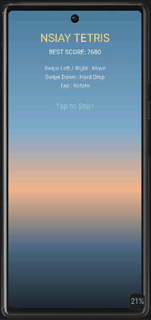
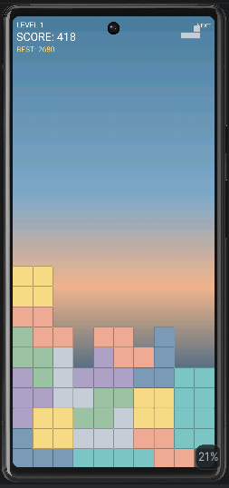
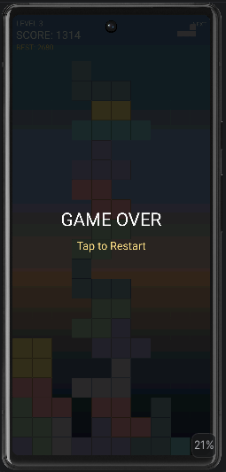

# Nsiay Tetris (Android)

Мобильная версия классического Тетриса, написанная на Kotlin с использованием нативного Android SDK.
Проект является портированием десктопной Java/JavaFX версии с полным сохранением бизнес-логики, но с
новым, адаптированным под сенсорные экраны интерфейсом.

## 📸 Скриншоты

|                 Стартовое меню                 |                  Игровой процесс                   |                     Game Over                      |
|:----------------------------------------------:|:--------------------------------------------------:|:--------------------------------------------------:|
|  |  |  |

## 📱 Основные возможности

- **Классический геймплей**: 7 фигур, вращение, очистка линий.
- **Современные механики**:
    - *7-bag randomizer* (гарантирует выпадение всех 7 фигур за цикл без длинных засух).
    - *Ghost Piece* (полупрозрачный силуэт, показывающий место падения).
    - *Next Piece* (превью следующей фигуры).
- **Нативное управление**: свайпы для движения и мгновенного сброса, тапы для поворота.
- **Сохранение прогресса**: Локальный рекорд сохраняется навсегда через `SharedPreferences`.
- **Адаптивный UI**: Градиентный фон, подстраивающийся под высоту экрана, и масштабируемое игровое
  поле.

## 🛠 Технологический стек

- **Kotlin** (основной язык UI-слоя и конфигурации).
- **Java** (переиспользованное ядро игры, 100% совместимость).
- **Android SDK** (SurfaceView, Canvas, GestureDetector, SharedPreferences).
- **JUnit 4** (Unit-тесты и Instrumented-тесты).
- **JaCoCo** (Анализ покрытия кода тестами).
- **Gradle (Kotlin DSL)** (сборка проекта, динамическое именование APK).
- **GitHub Actions** (CI/CD: сборка, тесты, покрытие).

## 🏗 Архитектура

Проект построен по паттерну **MVC (Model-View-Controller)**:

- **Model (Ядро)**: Пакет `core`. Чистая Java-логика (`GameState`, `Board`, `Tetromino`), не
  зависящая от Android SDK. Легко тестируется локально.
- **View (Отрисовка)**: `GameView.kt`. Наследуется от `SurfaceView`, использует отдельный поток для
  игрового цикла и рисует всё на `Canvas`.
- **Controller (Ввод)**: Обработчики касаний внутри `GameView.kt`, транслирующие свайпы и тапы в
  вызовы методов `GameState`.
- **Config (Настройки)**: `GameConfig.kt` и `ScoreManager.kt`. Централизованное хранение цветов,
  скоростей и работа с локальной памятью устройства.

## 📂 Структура проекта

Ниже представлена структура исходного кода и конфигурационных файлов проекта (без учета
сгенерированных папок `build/` и `.idea/`).

```text
NsiayTetris/
├── app/
│   ├── build.gradle.kts             # Конфигурация модуля приложения (зависимости, динамическое имя APK)
│   └── src/
│       ├── main/
│       │   ├── AndroidManifest.xml  # Главный манифест приложения (настройки Activity, тема)
│       │   ├── java/nsi/example/tetris/
│       │   │   ├── MainActivity.kt  # Точка входа (настройка полноэкранного режима)
│       │   │   ├── GameView.kt      # View-слой: отрисовка (SurfaceView) и обработка свайпов
│       │   │   ├── config/          # Настройки и сервисы
│       │   │   │   ├── GameConfig.kt   # Цвета, скорости, параметры поля (Single Source of Truth)
│       │   │   │   └── ScoreManager.kt # Сохранение рекордов через SharedPreferences
│       │   │   └── core/            # Model-слой: чистая бизнес-логика (100% Java)
│       │   │       ├── Board.java      # Игровая матрица, очистка линий
│       │   │       ├── GameState.java  # Игровой цикл, счет, уровни, 7-bag
│       │   │       ├── Point.java      # Координаты фигуры
│       │   │       └── Tetromino.java  # Математика поворотов фигур
│       │   └── res/                 # Ресурсы Android (иконки, layout, strings.xml, themes)
│       │
│       ├── test/java/nsi/example/tetris/core/       # Локальные Unit-тесты (JUnit)
│       │   ├── BoardTest.java
│       │   ├── GameStateTest.java
│       │   └── TetrominoTest.java
│       │
│       └── androidTest/java/nsi/example/tetris/config/ # Инструментальные тесты (работают на эмуляторе)
│           └── ScoreManagerTest.kt
│
├── docs/
│   ├── images/                      # Скриншоты для README
│   └── install/README.md            # Подробная инструкция по настройке Android Studio и эмулятора
│
├── gradle/
│   └── libs.versions.toml           # Version Catalog (управление версиями зависимостей)
│
├── build.gradle.kts                 # Корневой Gradle-файл
├── settings.gradle.kts              # Настройки проекта (rootProject.name = "NsiayTetris")
├── gradle.properties                # Флаги JVM для Gradle
└── README.md                        # Этот файл
```

## 🚀 Быстрый старт

Подробная пошаговая инструкция по установке Android Studio, настройке эмулятора Pixel 6 и запуску
проекта описана здесь:
👉 **[Инструкция по установке и настройке](docs/install/README.md)**

### Краткие команды (если среда уже настроена)

**Запуск игры на эмуляторе/телефоне:**
Нажмите кнопку **Run (▶)** в Android Studio или выполните:

```bash
./gradlew installDebug
```

**Запуск локальных тестов (без эмулятора):**

```bash
./gradlew test
```

**Запуск инструментальных тестов (требуется эмулятор):**

```bash
./gradlew connectedAndroidTest
```

**Генерация отчета о покрытии кода тестами (JaCoCo):**

```bash
./gradlew jacocoDebugCoverage
```

HTML-отчет появится по пути `app/build/reports/jacoco/jacocoDebugCoverage/html/index.html`.

**Сборка APK-файла:**
В меню Android Studio выберите **Build** -> **Generate App Bundles or APKs** -> **Generate APK (
s)**.
Готовый файл появится в `app/build/outputs/apk/debug/NsiayTetris-debug.apk`.

## ⚙️ CI/CD

Проект использует **GitHub Actions** для автоматической проверки качества при каждом push в `main`.

**Workflow** (`.github/workflows/ci.yml`):

1. Запускает **Unit-тесты** (`./gradlew test`).
2. Генерирует **отчёт о покрытии** JaCoCo (`./gradlew jacocoDebugCoverage`).
3. Собирает **Debug APK** (`./gradlew assembleDebug`).

**Артефакты** — [Actions → Android CI](https://github.com/nemtsevs/nsiay-tetris-android/actions/workflows/ci.yml):

1. Выберите последний успешный запуск (зелёная галочка).
2. Прокрутите вниз до блока **Artifacts**.
3. Скачайте:
    - `nsiay-tetris-debug-apk`: установочный APK (14 дней).
    - `coverage-report`: HTML-отчёт JaCoCo.

> ⚠️ **Важно для Windows-разработчиков:**
> Windows не сохраняет Unix-права (`chmod +x`) при клонировании. Если вы планируете пушить в GitHub
> и использовать CI на Linux, выполните один раз в терминале Android Studio (в корне проекта):
> ```bash
> git update-index --chmod=+x gradlew
> ```
> Это выставит права `100755` для файла `gradlew` в git. Без этого шага GitHub Actions упадёт с
> `./gradlew: Permission denied`.
>
> **Проверка:** `git ls-files -s gradlew` → должен показать `100755`.

## 🎮 Управление

| Действие                     | Жест                     |
|:-----------------------------|:-------------------------|
| Движение влево / вправо      | Свайп влево / вправо     |
| Мгновенный сброс (Hard Drop) | Свайп вниз (от 2 клеток) |
| Поворот по часовой стрелке   | Короткий тап по экрану   |
| Старт игры / Рестарт         | Тап по экрану            |

## 📄 Лицензия

Проект создан в учебных целях. Вы можете свободно использовать код для изучения Android-разработки.
